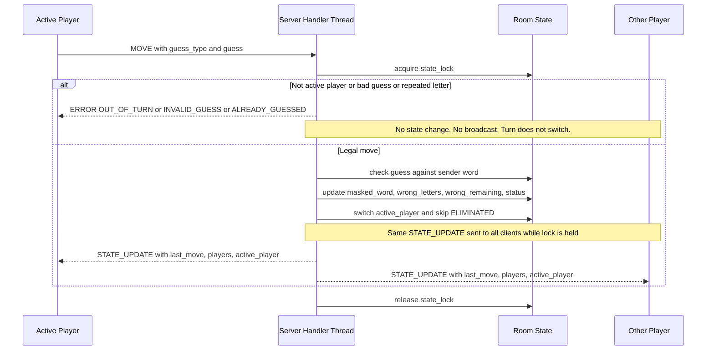

# State & Score Broadcast Sequence Diagram
 

 
**Narrative:** the server handler takes `state_lock` and validates the move: it must come from the active player and be a legal, not-yet-guessed guess. An invalid move gets an `ERROR` to the sender only, so nothing changes and the turn stays put. A legal move is checked against the sender's own word, and the server updates the sender's masked word, wrong letters, `wrong_remaining`, and `status`. It then switches `active_player` to the opponent, skipping any `ELIMINATED` player. Finally it sends the same `STATE_UPDATE` to both clients back-to-back while still holding the lock. Both players therefore receive identical turn and score information (`wrong_remaining`, `status`, `active_player`) from the same moment, and no other thread can change the state in between.
